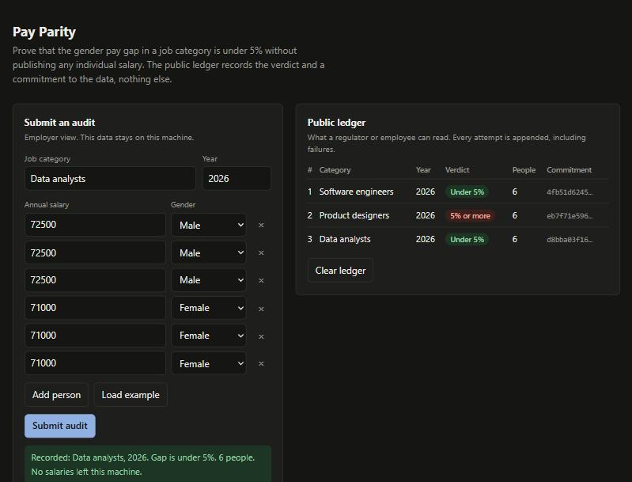
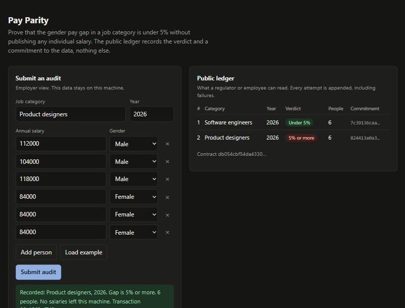

# pay-parity

Prove that the gender pay gap in a job category is under 5% without publishing a single salary.

Built for the Midnight Buildathon (Wave 2). The contract is written in Compact and the public ledger only ever sees a verdict, a headcount and a commitment.



## The problem

The EU Pay Transparency Directive (2023/970) makes employers report gender pay gaps, and an unexplained gap of 5% or more in a job category triggers a joint pay assessment with worker representatives. Member states were due to transpose it by 7 June 2026, and employers are now working out how to evidence compliance.

That creates an awkward conflict. Regulators and worker representatives need proof. Employers don't want payroll on a public ledger, and in a small category even an average can point at one person. Sharing a spreadsheet with an auditor works once, but it leaves no tamper-evident record, and the auditor ends up holding everyone's pay.

Zero-knowledge proofs fit this well: the employer proves a statement about data only they hold.

## What it does

For one job category and year, the employer submits up to eight pay records privately. The contract checks:

- every record is counted by group (female / male) and the group sums are computed inside the circuit
- each group has at least two people, so a verdict can't expose one person's pay
- the gap is under 5%, defined as the directive does: `(avg male - avg female) / avg male < 5%`
- exactly 5% counts as non-compliant, matching "5% or more"

The ledger then records the verdict, the headcount and a commitment to the payroll. Nothing else.

Every attempt is appended to a log, passing or failing. An employer can't re-run an audit until it passes and hide the earlier tries.

## How it uses Midnight

Midnight keeps two kinds of state, and this project leans on both.

Public ledger state (what everyone can read):

| Field | Purpose |
| --- | --- |
| `employer` | Hash of the employer's secret key, sealed at deployment. Only the holder of the key can submit. |
| `submissions` | Counter, used as the next log index. |
| `audits` | Append-only map from index to `{ category, period, compliant, headcount, commitment }`. |

Private state (supplied through witnesses, never leaves the employer's machine):

| Witness | Purpose |
| --- | --- |
| `employerSecret` | Proves the caller is the employer. |
| `payBatch` | The eight pay records: salary, gender, active flag. |
| `batchSalt` | Randomness for the commitment. |

The circuit works on the private batch and discloses only what the verdict needs. The compiler enforces this: values derived from witnesses can't reach the ledger without an explicit `disclose()`, so every line that makes something public is marked in the source: the verdict, the headcount and the log entry.

The commitment is `persistentCommit(batch, salt)`. It binds the employer to the payroll they audited. If a regulator later receives the real payroll and the salt, they can recompute the commitment and check it matches the ledger, so the data can't be swapped after the fact. The salt keeps the commitment hiding.

The contract is in [`contracts/pay-parity.compact`](contracts/pay-parity.compact).

## Repository layout

```
contracts/pay-parity.compact   the Compact contract
contracts/index.ts             the compiled contract, wired to its witnesses
src/witnesses.ts               private state and witness implementations
src/payroll.ts                 batch padding and input validation
src/simulator.ts               runs the compiled contract in-process
src/chain.ts                   deploy the contract and submit audits on a network
src/network/                   wallet, providers and session for a Midnight network
demo/server.ts                 employer-side backend for the demo (two modes)
demo/public/index.html         the web UI
test/                          contract tests and API tests, no network needed
e2e/                           end-to-end tests against a local Midnight network
packages/fast-sync/            wallet harness vendored from Midnight's examples
compose.yml                    local node, indexer and proof server
```

## Running it

Requirements: Node 22, and the Compact toolchain pinned to 0.31.1 (the version in Midnight's current Preprod support matrix). Compact doesn't run natively on Windows; use WSL.

```bash
curl --proto '=https' --tlsv1.2 -LsSf https://github.com/midnightntwrk/compact/releases/latest/download/compact-installer.sh | sh
compact update 0.31.1

npm ci
npm run compile     # compiles the contract and generates the proving keys
npm test            # 31 tests, no network needed
npm run demo        # http://127.0.0.1:3000, runs the contract in-process
```

To run against a real Midnight network, you also need Docker:

```bash
npm run env:up      # local node, indexer and proof server
npm run wait:dust   # waits until the dev wallet can pay fees
npm run test:e2e    # 8 tests: real deploy, real proofs, real transactions
npm run demo:chain  # the same UI, every audit is a proven transaction
npm run env:down
```

## How to evaluate it

1. `npm run compile` should finish without errors. This is the contract gate.
2. `npm test` runs the suite. The tests that matter most:
   - boundary cases for the 5% rule (exactly 5% fails, one unit under passes)
   - rejection of groups smaller than two, and of anyone but the employer
   - a check that no salary appears in the public state, either as a decimal or as the little-endian bytes the ledger stores
   - the commitment is binding (a changed payroll changes it) and hiding (a new salt changes it)
   - the audit log keeps submission order, which the ledger map does not do by itself
3. `npm run demo`, then use "Load example" and "Submit audit". Change the female salaries to something lower and submit again. Then remove two women so the group drops below two and submit: the contract's own message comes back and nothing is recorded.
4. With Docker, `npm run test:e2e` runs the same checks on a real network. It deploys the contract, submits audits that each carry a zero-knowledge proof, rejects bad ones before any proof is made, reads the public state back from the indexer and scans it for every salary, and checks that replaying the payroll with the same salt reproduces the on-chain commitment.

CI compiles, typechecks and runs the unit tests on every push. The end-to-end workflow needs Docker and runs on demand from the Actions tab. A fresh clone passes with `npm ci` followed by the commands above.



The slide deck is in [`docs/pay-parity-deck.pptx`](docs/pay-parity-deck.pptx), and the notes for the submission form are in [`docs/submission.md`](docs/submission.md).

## Limitations

These are real, and worth knowing before relying on this.

- **Tested on a local network, not a public one.** The contract has been deployed and called with real proofs on a local Midnight network, using the images from Midnight's own examples (node 1.0.0, indexer 4.3.3, proof server 8.1.0). Those are close to, but not identical to, the versions on the Preprod support matrix. It hasn't been deployed to Preprod or Preview yet, which needs a funded wallet.
- **The input is trusted.** The contract proves that the data the employer supplied meets the rule. It can't know the data is the true payroll. The commitment makes later disputes checkable, but nothing here attests the payroll at source.
- **Binary gender.** The directive's formula compares female and male pay, and this follows it.
- **Eight people per audit.** Compact loops are bounded, so each proof covers a fixed batch. Larger categories need several batches, which is not built yet.
- **Whole-number salaries up to 2^32 - 1**, in one currency per audit.
- **The demo holds the employer key on the server it runs on.** That is the employer's own machine in this design, but the demo isn't hardened for anything else.

## Roadmap

- Deploy to Preprod with a funded wallet.
- Larger categories: several batches combined into one verdict.
- Payroll attestation: a signed export from an HR or payroll system, checked in the circuit.
- Employee self-check: prove a worker's own record is part of an audited batch, using a Merkle tree of record commitments.
- Regulator tooling for opening a commitment against a payroll file.

## License

Apache-2.0, see [LICENSE](LICENSE).
